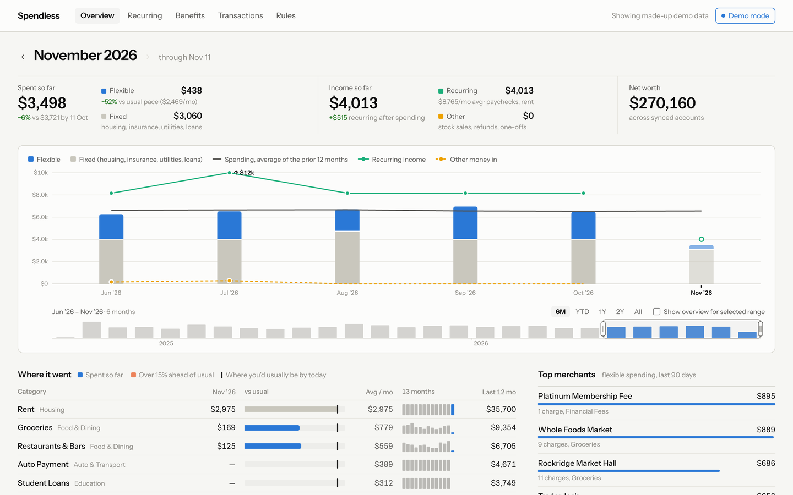
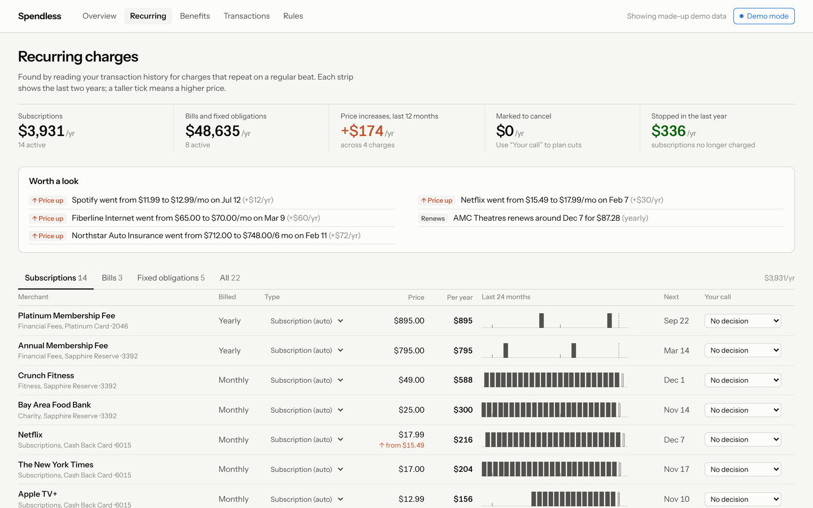
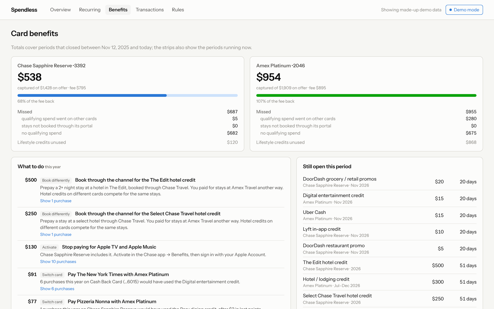
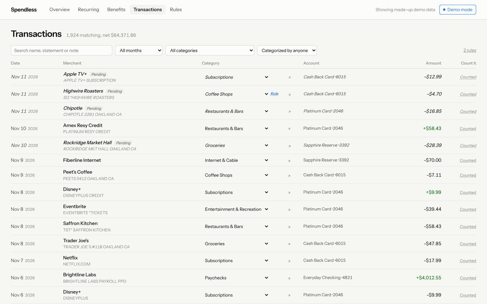

# Spendless

A private personal-finance dashboard that runs on your own machine. It keeps its own copy of your
[Monarch](https://www.monarchmoney.com) transactions in SQLite, lets you recategorize with rules, finds
recurring charges straight from your history, and tracks how much value you get out of your credit card benefits.



| Recurring charges | Card benefits |
| --- | --- |
|  |  |



*Screenshots use the built-in demo mode, which shows made-up data.*

## Requirements

- Node ≥ 22.13 (uses the built-in `node:sqlite`). [mise](https://mise.jdx.dev) pins it for you.
- A Monarch account for your data. You don't need one to try the app: demo mode works without it.
- Optional: an [OpenRouter](https://openrouter.ai) API key, used to classify ambiguous card-benefit purchases.

## Setup

```sh
git clone <this repo> && cd spendless
mise trust && mise install      # installs the pinned Node
mise run dev                    # http://127.0.0.1:5173
```

Without mise: `npm install && npm run dev`, using Node 22. Every `mise run <task>` has an `npm run` equivalent.
`mise tasks` lists them: `dev`, `build`, `start`, `check`, `import:csv`, `sync`, `recurring`, `benefits`.

To look around before connecting anything, click **Demo mode** in the header.

## Loading your data

**History from a CSV.** In Monarch, go to Transactions → ⋯ → Download transactions, then save the file
in `data/` and run:

```sh
mise run import:csv             # imports the newest CSV in data/ (or pass a path); safe to re-run
```

**Ongoing sync from Monarch's MCP server.** This uses read-only OAuth access.

```sh
mise run sync                   # first run opens a browser to approve; re-pulls the last 45 days
mise run sync -- --since 2026-01-01
```

Tokens are saved in `data/monarch-auth.json` (mode 600). After the first sign-in, the **Sync now**
button in the app works too.

**Card benefits (optional).** Add your key to `.env`:

```sh
OPENROUTER_API_KEY=sk-or-...
# SPENDLESS_LLM_MODEL=google/gemini-3.1-flash-lite   # default
```

Every sync then asks the model about new purchases that the regexes can't settle. Answers are cached per transaction.

Everything in `data/` and `.env` is git-ignored. That includes your database, CSVs and tokens.

### Sync on a schedule (macOS)

Create `~/Library/LaunchAgents/com.spendless.sync.plist` with
`ProgramArguments` = `/bin/sh -lc "cd /path/to/spendless && mise run sync"` and `StartInterval` = `14400`,
then run `launchctl load` on it.

## Running it for real

```sh
mise run start                  # production build on http://127.0.0.1:3000
```

There is no authentication. It binds to localhost, so keep it that way or put it behind something that
does authentication.

## More

- Cards supported for benefits: Chase Sapphire Reserve and Amex Platinum. To add one, write a file in
  `src/lib/server/benefits/cards/`.
- [docs/architecture.md](docs/architecture.md) covers the data model, rules, recurring detection, the
  benefits engine and demo mode.
